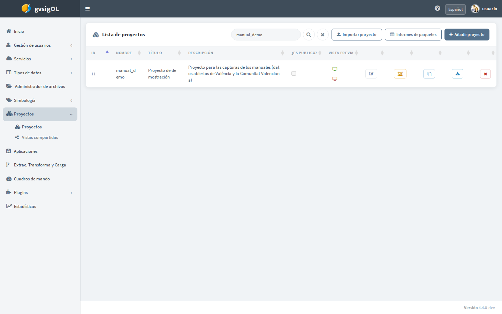
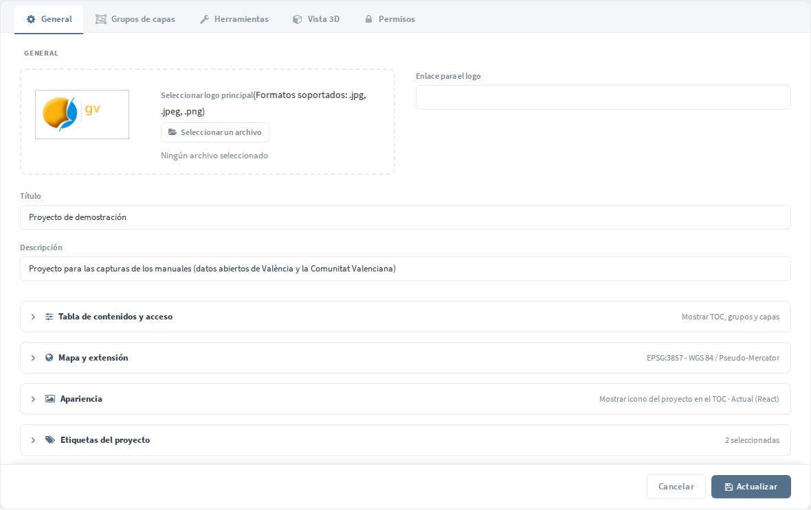
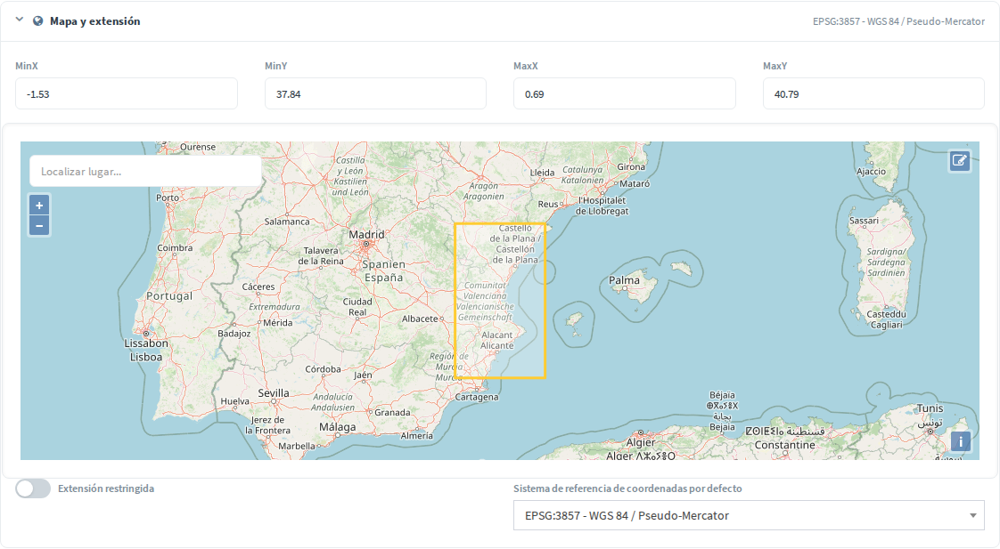
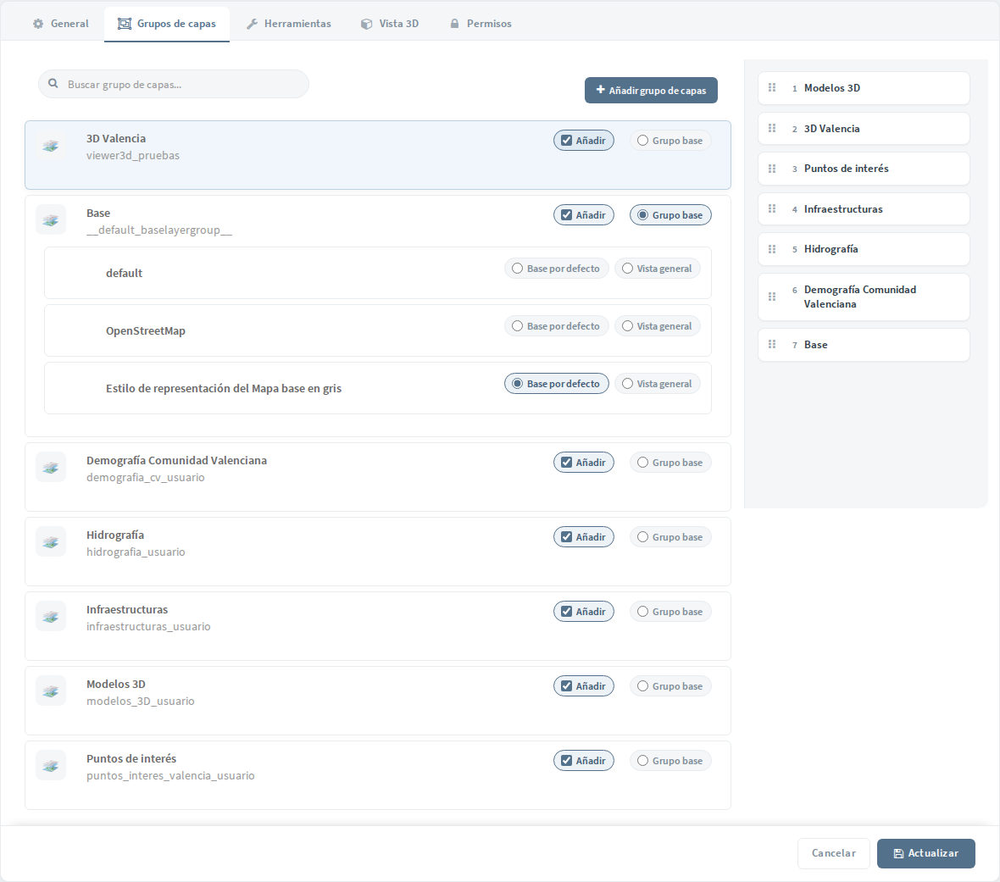
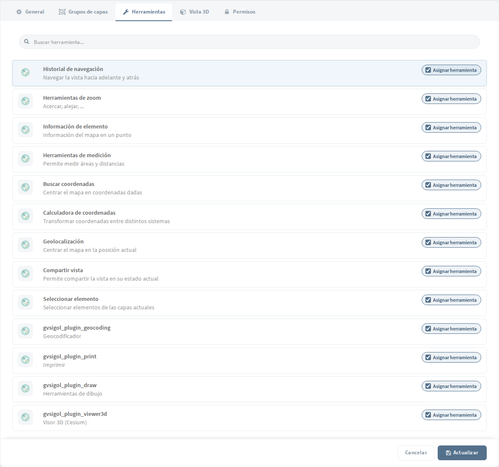
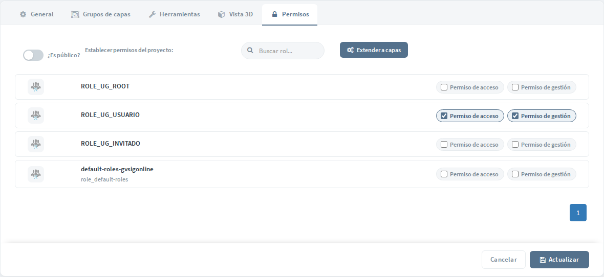
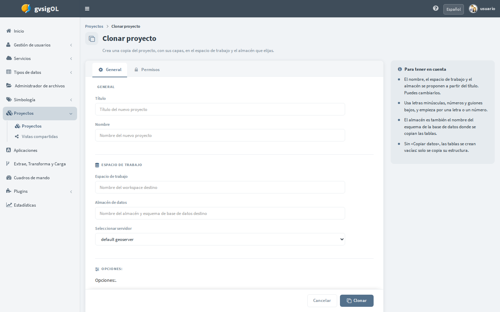
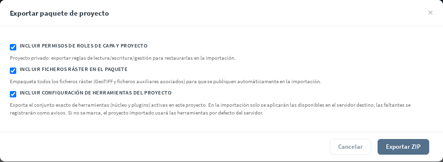

# Gestión de proyectos

Un **proyecto** es un visor de mapas: reúne unos grupos de capas, las herramientas que se ofrecen
al usuario, sus capas base y quién puede abrirlo. Cada proyecto tiene su propia dirección y se
puede abrir en el visor actual o en el clásico.

Los proyectos se gestionan desde el panel de administración, en **Proyectos**.

## Quién puede hacer qué

| Acción | Quién |
|---|---|
| Ver la lista de proyectos | Personal (*staff*) y superusuarios. Los superusuarios ven todos; el resto, los proyectos en los que alguno de sus roles tiene permiso de acceso o de gestión |
| Crear un proyecto | Personal y superusuarios |
| Modificar, exportar o eliminar un proyecto | Quien lo gestiona: los superusuarios, quien lo creó y quien tenga un rol con **Permiso de gestión** en el proyecto |
| Clonar un proyecto | Solo superusuarios |
| Extender los permisos del proyecto a sus capas | Solo superusuarios |

## Lista de proyectos

La lista muestra el nombre, el título, la descripción y si el proyecto es público. El buscador
filtra por nombre, título y descripción, y la tabla se pagina.

En cada fila:

- **Vista previa**: abre el proyecto en el visor actual (icono verde) o en el clásico (icono marrón),
  en una pestaña nueva.
- **Grupos de capas del proyecto**: lleva a la lista de grupos de capas filtrada por ese proyecto.
- **Actualizar proyecto**: abre el formulario del proyecto.
- **Clonar proyecto**: crea una copia (ver [Clonar un proyecto](#clonar-un-proyecto)).
- **Exportar paquete de proyecto**: genera un ZIP para llevar el proyecto a otro servidor (ver
  [Exportar e importar paquetes](#exportar-e-importar-paquetes)).
- **Eliminar proyecto**: pide confirmación y lo borra. Se borra el proyecto, no sus capas ni sus
  grupos de capas.

Si no puede gestionar un proyecto, sus botones aparecen desactivados.

## Crear un proyecto

Pulse **Añadir proyecto**. El formulario es el mismo que el de modificación, con un campo más, el
**Nombre**:

- Es el identificador del proyecto y forma parte de su dirección, por lo que **no se puede cambiar
  después**.
- Solo admite letras sin acentos, números, guiones y guiones bajos. Los espacios y los demás
  caracteres se eliminan al guardar.
- No puede repetirse: si ya existe un proyecto con ese nombre, el formulario lo indica.

Al guardar, el rol de administración y el rol principal de quien lo crea reciben siempre permiso
de acceso y de gestión, aunque no se marquen.

El formulario se organiza en cuatro pestañas: **General**, **Grupos de capas**, **Herramientas** y
**Permisos**. Algunos plugins añaden pestañas propias; por ejemplo, el visor 3D añade **Vista 3D**
(ver la [guía del visor 3D](doc:gvsigol_plugin_viewer3d/index.md)).

## Pestaña General

### Datos del proyecto

- **Logo principal** y **Enlace para el logo**: imagen que se muestra en la cabecera del visor y
  dirección a la que lleva al pulsarla.
- **Título**: el nombre que ven los usuarios.
- **Descripción**: texto breve que acompaña al proyecto en las listas.

### Tabla de contenidos y acceso

- **Presentación del panel TOC**: cómo se abre la tabla de contenidos del visor:
  **TOC oculto**, **Mostrar TOC y grupos** o **Mostrar TOC, grupos y capas** (desplegada).
- **Grupos de capas seleccionables**: permite encender y apagar un grupo entero de una vez.
- **Fecha de caducidad (opcional)**: a partir de esa fecha el proyecto deja de aparecer en las
  listas de proyectos de los usuarios y en la de proyectos públicos. Déjela vacía si no debe
  caducar; **Borrar fecha de caducidad** la quita.

### Mapa y extensión

- El **mapa** fija la vista inicial del proyecto: el centro y el nivel de zoom con que se abre son
  los del mapa al guardar. Si está instalado el geocodificador, el buscador **Localizar lugar…**
  ayuda a llegar a la zona.
- **MinX**, **MinY**, **MaxX** y **MaxY**: la extensión del proyecto en grados (EPSG:4326). Se
  rellenan solos al dibujar un rectángulo sobre el mapa, o se pueden escribir.
- **Extensión restringida**: limita la navegación del visor a esa extensión.
- **Sistema de referencia de coordenadas por defecto**: el sistema en que el visor muestra las
  coordenadas al abrirse.

### Apariencia

- **Imagen del proyecto**: la que lo representa en las listas de proyectos. **¿Cambiar imagen?**
  permite sustituirla.
- **Mostrar icono del proyecto en el TOC**.
- **Tecnología del visor**: **Actual (React)** o **Clásico (Bootstrap)**. Solo se ofrecen las que
  la instalación tiene activas.
- **Etiquetas del proyecto**: clasifican el proyecto (por ejemplo, *viewer*, *public*, *mobile*).
  La lista de etiquetas la define la instalación; algunas aplicaciones, como la móvil, las usan
  para elegir qué proyectos mostrar.

## Pestaña Grupos de capas

Marque los grupos de capas que forman el proyecto. El buscador filtra la lista por nombre.

- **Grupo base**: uno de los grupos marcados hace de grupo de capas base (el mapa de fondo).
  Dentro de él:
    - **Base por defecto**: la capa base con la que se abre el visor.
    - **Vista general**: la capa que se usa en el mapa de situación. Si no se elige ninguna, se usa
    la vista general por defecto.
- **Añadir grupo de capas** crea un grupo nuevo sin salir del proyecto. Para ello el proyecto debe
  guardarse primero: el formulario lo pide y, al terminar, vuelve al proyecto.

A la derecha se ve la tabla de contenidos tal como la verá el usuario. Arrastre los grupos por su
asa (⋮⋮) para cambiar el orden; el grupo base va siempre debajo de los demás.

## Pestaña Herramientas

Marque las herramientas que tendrá el visor: las del núcleo (zoom, información de elementos,
medir, buscar coordenadas, compartir vista…) y las de los plugins instalados (edición, impresión,
dibujo, visor 3D…). El buscador filtra por nombre.

Los plugins que no se marcan aquí no aparecen en el visor del proyecto, y sus manuales tampoco se
ofrecen desde los paneles de ese proyecto.

## Pestaña Permisos

- **¿Es público?**: cualquiera puede abrir el proyecto, también sin iniciar sesión. Las capas del
  proyecto siguen teniendo sus propios permisos: un proyecto público con capas privadas solo
  muestra las capas que el usuario puede ver.
- Para cada rol:
    - **Permiso de acceso**: los usuarios con ese rol pueden abrir el proyecto.
    - **Permiso de gestión**: además, pueden modificarlo, exportarlo y eliminarlo.
- **Extender a capas** (solo superusuarios): da a los roles marcados permiso de lectura sobre
  todas las capas del proyecto. Tenga en cuenta que:
    - Si el proyecto es público, todas sus capas pasan a ser públicas.
    - Actúa sobre las capas, grupos y roles marcados en el formulario, aunque no se hayan guardado.
    - No quita los permisos que ya tuvieran las capas, y las capas públicas siguen siéndolo.

El rol de administración conserva siempre el acceso y la gestión del proyecto.

Pulse **Actualizar** (o **Guardar** al crearlo) para guardar los cambios, o **Cancelar** para
salir sin guardar.

## Clonar un proyecto

**Clonar proyecto** crea una copia del proyecto con sus capas en el espacio de trabajo y el almacén
de datos que elija. Solo pueden hacerlo los superusuarios.

- **Nombre** y **Título** del proyecto nuevo. El nombre, el espacio de trabajo y el almacén de
  datos se proponen a partir del título y se pueden cambiar. Use minúsculas, números y guiones
  bajos, y empiece por una letra o un número.
- **Servidor**, **Workspace** y **Almacén de datos** de destino. El almacén de datos es también el
  esquema de base de datos donde se copian las tablas.
- **Copiar datos**: sin esta opción las tablas se crean vacías; solo se copia su estructura.
- **Clonación de permisos**: **Clonar permisos de proyecto y capas**, o **No aplicar ningún
  permiso**; en ese caso, **las capas clonadas serán públicas**.

Al clonar:

- Las capas vectoriales se clonan.
- Las capas ráster no se incluyen, salvo las capas base.
- Los grupos de capas base se enlazan, no se copian.

## Exportar e importar paquetes

Un **paquete de proyecto** es un ZIP con el proyecto, sus grupos de capas y sus capas, pensado para
llevarlo a otro servidor gvSIG Online.

### Exportar

**Exportar paquete de proyecto** abre un diálogo con las opciones:

- **Incluir permisos de roles de capa y proyecto**: en proyectos privados, exporta las reglas de
  lectura, escritura y gestión para restaurarlas al importar.
- **Incluir ficheros ráster en el paquete**: empaqueta los GeoTIFF y sus ficheros auxiliares para
  que se publiquen automáticamente al importar.
- **Incluir configuración de herramientas del proyecto**: exporta las herramientas activas. Al
  importar solo se aplican las que existan en el servidor de destino; las que falten se registran
  como avisos. Si no se marca, el proyecto importado usa las herramientas por defecto del servidor.
- **Capas en bases de datos externas** y **Vistas SQL**: para cada capa, elija **Datos (GPKG)**
  (se copian los datos) o **Definición** (se copia la definición de la capa y la conexión o la de la
  vista SQL).

**Exportar ZIP** genera el fichero; en proyectos grandes puede tardar varios minutos.

### Importar

**Importar proyecto**, en la cabecera de la lista, pide el fichero de paquete (.zip) exportado
desde otro servidor y abre un asistente para revisar la importación.

**Informes de paquetes** muestra el registro de las importaciones y exportaciones, con su estado y
sus avisos.
